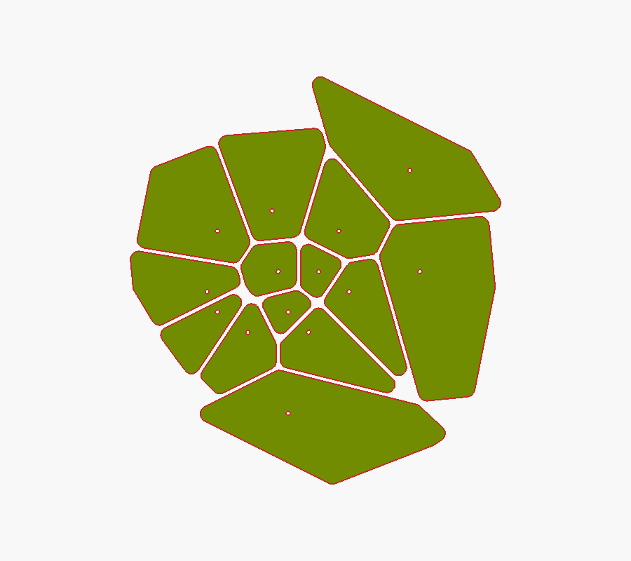
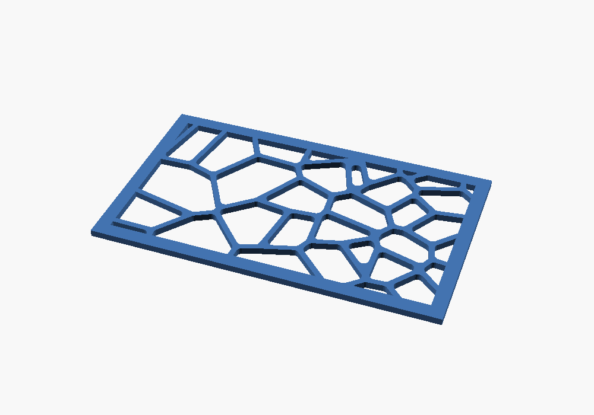
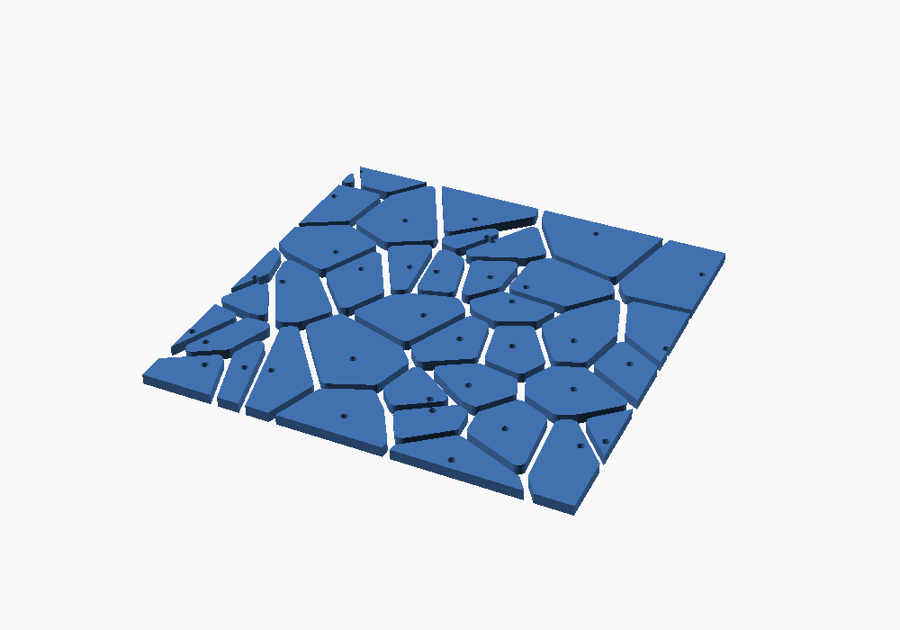
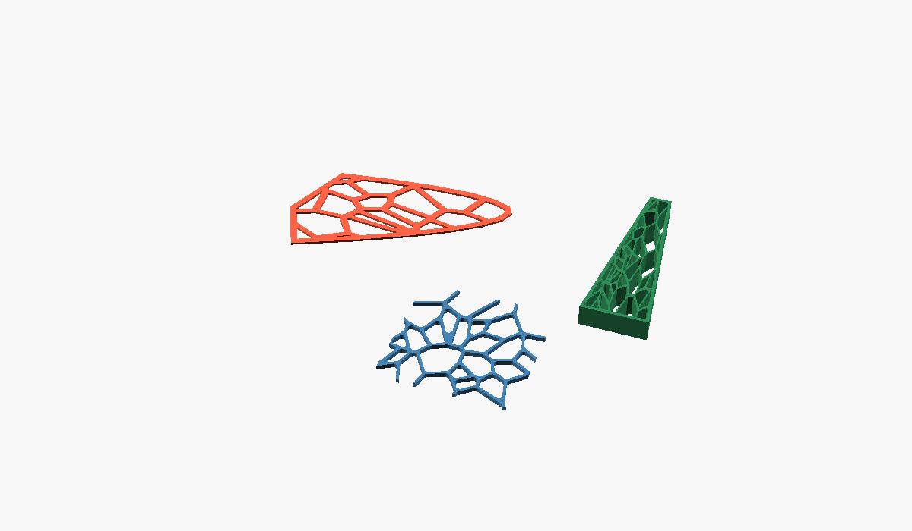

# voronoi-scad

Voronoi patterns in OpenSCAD: rounded cells around sites you place or seed at
random, for perforated panels, tiles and lattices. Each site gets the region
closer to it than to any other site, pulled in from every neighbour so a web
of even width runs between cells, with rounded corners.





## Use it

```openscad
use <voronoi-scad/voronoi.scad>

// Cells around sites you choose
voronoi([[0, 0], [30, 0], [20, 10], [50, 20], [15, 30]], thickness = 1, round = 4);

// 40 random sites, the same pattern for the same seed
random_voronoi(n = 40, min = 0, max = 120, seed = 42, center = true);

// A polygon filled with a Voronoi web and a solid rim
voronoi_polygon([[0, 0], [60, 10], [80, 60], [30, 90], [-10, 50]], n = 30, edging = 3, seed = 7);
```

Each module draws 2D shapes; extrude them with `linear_extrude()` for a solid.

| Module | What it draws |
| --- | --- |
| `voronoi(points, L, thickness, round, nuclei, nucleus_r)` | One cell per site. The web between two cells is `2 * thickness` wide and corners are rounded to `round`. `nuclei` punches a hole of `nucleus_r` at each site. `L` limits how far an outer cell reaches. |
| `random_voronoi(n, nuclei, L, thickness, round, min, max, seed, center)` | `voronoi()` over `n` random sites in `[min, max]` on both axes. The same `seed` gives the same pattern; with none, one is drawn and echoed. `center` moves the sites' midpoint to the origin. |
| `voronoi_polygon(border, n, thickness, round, edging, seed)` | The polygon less a random pattern: the web, with a solid rim `edging` wide. |

| Function | Returns |
| --- | --- |
| `voronoi_cell(points, i, L, inset)` | Site `i`'s cell as a list of points, pulled in by `inset` from every neighbour, for use in your own geometry. |
| `random_points(n, lo, hi, seed)` | The random sites `random_voronoi()` uses. |

Keep `thickness` and `round` in proportion to the sites' spacing: a cell
narrower than `2 * (thickness + round)` vanishes. An outer cell has no
neighbour beyond it, so it runs out to `L`; trim the pattern with
`intersection()` or use `voronoi_polygon()` when the edge matters.





The module names and parameters follow Felipe Sanches's
[OpenSCAD_Voronoi_Generator](https://github.com/felipesanches/OpenSCAD_Voronoi_Generator),
and for the same calls this library draws the same cells, except that `center`
now centres the sites' midpoint. This is a separate implementation: it computes
each cell as a polygon by clipping, which is about 9 times faster at 400 sites
(0.73 s against 6.80 s on OpenSCAD 2026.10.15).

## Checks

`just test` takes about 3 s on OpenSCAD 2026.10.15. It checks that:

- every vertex of every cell of 40 random sites lies at least `inset` inside
  its bisector with every other site, and each site lies in its own cell;
- the web between cells is `2 * thickness` wide: cells grown by just under
  `thickness` stay apart, and grown by a little more, they meet;
- a seed repeats its pattern and another changes it, and `center` moves the
  sites' midpoint to the origin;
- `voronoi_polygon()` stays inside its border and its rim is solid;
- five fixed cases keep the volumes in `tests/volumes.txt`, which are the
  volumes OpenSCAD_Voronoi_Generator gives for the same calls;
- every example evaluates without warnings, and a single site is refused.

`just images` renders the pictures.

## Licence

MIT; see [LICENSE](LICENSE).
